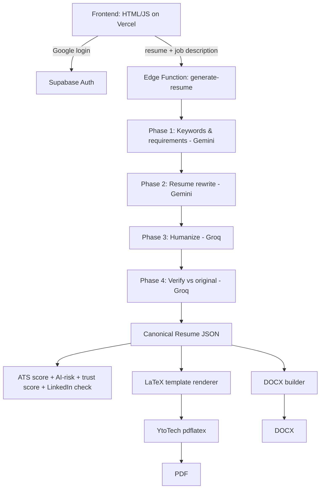

# Launch-My-CV
LaunchMyCV is an AI-powered, ATS-focused resume builder. Paste your resume and a job description, pick a template, and get a tailored resume without invented skills or metrics. It gives an ATS match score, missing keywords, and an AI-risk check, then exports PDF, DOCX, or LaTeX

# 🚀 LaunchMyCV
**AI-powered, ATS-focused resume builder.**
Paste your resume + a job description → get a tailored, honest, ATS-friendly resume as **PDF, DOCX, or LaTeX**.


[Live Demo](https://launchmycv-theta.vercel.app/) · [Report a Bug](../../issues) · [Request a Feature](../../issues)


---

## 📖 Table of Contents

- [About](#-about)
- [Features](#-features)
- [How It Works](#-how-it-works)
- [Tech Stack](#-tech-stack)
- [Project Structure](#-project-structure)
- [Getting Started](#-getting-started)
- [Environment & Secrets](#-environment--secrets)
- [ATS Scoring](#-ats-scoring)
- [Testing](#-testing)
- [Roadmap](#-roadmap)
- [Known Limitations](#-known-limitations)
- [Security](#-security)
- [Contributing](#-contributing)
- [License](#-license)
- [Author](#-author)

---

## 💡 About

Most resumes are filtered by Applicant Tracking Systems (ATS) before a human ever reads them. Generic AI resume tools often make this worse: they stuff buzzwords, sound robotic, or invent metrics that were never in your resume.

**LaunchMyResume** tailors your existing resume to a specific job description **without fabricating anything**, tells you how well it matches, and exports a clean, machine-readable document. It is built to run entirely on **free tiers**, so students and fresh graduates can use it without paying for expensive tools.

---

## ✨ Features

| | Feature | Description |
|---|---|---|
| 🎯 | **Job-tailored rewriting** | Extracts keywords and requirements from the job description and rewrites your resume around them at a natural coverage, not keyword stuffing. |
| 🧠 | **4-phase AI pipeline** | Keyword extraction → rewrite → humanize → verification, with validated typed JSON passed between phases. |
| 🔁 | **Two providers, bounded failover** | Google Gemini and Groq with capped retries, 429 rate-limit handling, per-attempt timeouts and a request deadline. |
| 🏢 | **ATS target profiles** | Optimize for Workday, Greenhouse, Lever, or Generic. |
| 📊 | **Deterministic ATS score (0-100)** | Same resume + same job description = same score, backed by matched and missing keywords. |
| ⚠️ | **Actionable warnings** | Flags weak bullets, missing sections, and parsing risks. |
| 🤖 | **AI-risk indicator** | Green / Yellow / Red rating for buzzword-heavy, robotic phrasing. |
| ✅ | **Verification & trust score** | Claims are checked against your original resume so unsupported content can be removed. |
| 🔗 | **LinkedIn consistency check** | Optional check that flags title and date mismatches. |
| 🎨 | **Multiple LaTeX templates** | One canonical resume JSON rendered into many layouts. Changing the template never changes your content. |
| 📄 | **PDF, DOCX & LaTeX export** | PDF compiled from LaTeX; DOCX and `.tex` also available. |
| 👤 | **Google sign-in & history** | Each user keeps their own resumes; every generation has its own ID. |
| 🔒 | **Duplicate-safe generation** | Idempotent jobs: no double runs, no overlapping requests. |

---

## ⚙️ How It Works



### Design principles

1. **One canonical Resume JSON** is the source of truth. Templates control presentation only.
2. **Never fabricate.** If the original resume has no verifiable metric, the system does not invent or estimate one.
3. **AI interprets, code scores.** The numeric ATS score comes from deterministic code, not from an LLM.
4. **ATS-safe output.** Plain-text contact info, standard headings, machine-readable dates, no skill bars or text-as-graphics.
5. **Keys stay server-side.** API keys live only in Supabase secrets.
6. **Fail clearly.** Retries are bounded and errors are normalized instead of silently lowering quality.

---

## 🧰 Tech Stack

| Layer | Technology |
|---|---|
| Frontend | Vanilla HTML / CSS / JavaScript (single page) |
| Hosting | Vercel (auto-deploy from GitHub) |
| Auth & Database | Supabase (Google OAuth, PostgreSQL, Row Level Security) |
| Backend | Supabase Edge Functions (Deno + TypeScript) |
| AI | Google Gemini API, Groq API (`openai/gpt-oss-120b`) |
| PDF | LaTeX templates compiled via YtoTech (`pdflatex`) |
| DOCX | `docx` library |

---

## 📁 Project Structure

```text
.
├── public/
│   └── index.html                  # Frontend
├── vercel.json
└── supabase/
    ├── migrations/                 # resumes, conversations, generation_jobs tables
    └── functions/generate-resume/
        ├── index.ts                # Orchestrator: auth, validation, phases, outputs
        ├── types.ts / schema.ts    # Typed contracts and validators
        ├── providers/              # Gemini + Groq adapters, error normalization
        ├── jobs-registry.ts        # generation_id idempotency / state machine
        ├── prompts/                # Phase 1-4 prompts
        ├── rag/                    # Resume parser, fact-checker, trust scorer
        ├── scoring/                # ATS score, AI-risk score
        ├── ats-profiles/           # Workday, Greenhouse, Lever, Generic
        ├── consistency/            # LinkedIn mismatch check
        ├── latex/                  # build-latex.ts + resume templates
        ├── pdf/                    # YtoTech client
        ├── docx/                   # DOCX builder
        └── test/                   # Failover and idempotency tests
```

---

## 🚀 Getting Started

### Prerequisites

- [Node.js](https://nodejs.org/) and the [Supabase CLI](https://supabase.com/docs/guides/cli)
- A free [Supabase](https://supabase.com/) project
- A [Google Gemini API key](https://aistudio.google.com/) and a [Groq API key](https://console.groq.com/)
- A Google Cloud OAuth client (for Google sign-in)

### 1. Clone the repository

```bash
git clone https://github.com/bvssathvik/Launch-My-Resume.git
cd Launch-My-Resume
```

### 2. Set up the database

Run the SQL files in `supabase/migrations/` in the Supabase SQL Editor, or:

```bash
supabase db push
```

### 3. Enable Google sign-in

In Supabase → **Authentication → Providers**, enable **Google** and paste your OAuth client ID and secret. Add your deployed URL to the allowed redirect URLs.

### 4. Set secrets and deploy the function

Run these from the project root:

```bash
supabase link --project-ref <your-project-ref>
supabase secrets set GEMINI_API_KEY=<your-gemini-key>
supabase secrets set GROQ_API_KEY=<your-groq-key>
supabase functions deploy generate-resume
```

### 5. Configure and deploy the frontend

1. Put your Supabase **project URL** and **anon key** in `public/index.html`.
2. Push the repo to GitHub.
3. Import it into [Vercel](https://vercel.com/) and deploy.

---

## 🔐 Environment & Secrets

Set these as **Supabase secrets**. Never commit them.

| Name | Required | Purpose |
|---|---|---|
| `GEMINI_API_KEY` | Yes | Phases 1-2 (and failover) |
| `GROQ_API_KEY` | Yes | Phases 3-4 (and failover) |
| `GEMINI_MODEL` | No | Override the default Gemini model |
| `GROQ_MODEL` | No | Override the default Groq model (`openai/gpt-oss-120b`) |

> Secret names must match exactly: underscores, no spaces.

---

## 📊 ATS Scoring

The ATS score is a **deterministic, rule-based estimate** of how well a resume matches a specific job description. It is **not** an employer's real ATS score, because real systems are proprietary and vary by company.

| Category | Weight |
|---|---:|
| Required skills / must-have keywords | 50% |
| Important keywords | 30% |
| Exact phrase matches | 10% |
| Structure & parsability | 10% |
| Title alignment bonus | +4 pts (+8 for Workday) |

Matching is strict (whole words and consecutive-token phrases, plural-only inflection) to avoid inflated scores from substring matches.

---

## 🧪 Testing

Failover and idempotency are tested with a mocked `fetch`, so no real API keys are needed:

```bash
deno test --allow-env supabase/functions/generate-resume/test/
deno check supabase/functions/generate-resume/index.ts
```

Covered cases include Gemini 429 → Groq, Groq 429 → Gemini, timeouts, 5xx errors, auth failures, invalid JSON with one controlled repair, and duplicate or replayed `generation_id`s.

---

## 🗺 Roadmap

- [x] Four-phase Gemini + Groq pipeline with bounded failover
- [x] Deterministic ATS score with matched and missing keywords
- [x] AI-risk indicator and verification trust score
- [x] Multiple LaTeX templates from one canonical resume JSON
- [x] PDF, DOCX and LaTeX export
- [x] Google sign-in and per-user resume history
- [ ] PDF-level content validation (extract PDF text and compare with the source JSON)
- [ ] Automated layout checks (overflow, clipping, page-count gates)
- [ ] Template regression test suite committed to the repo
- [ ] Self-hosted PDF compilation (remove dependency on YtoTech)
- [ ] Containerized FastAPI + Docker backend option

---

## ⚠️ Known Limitations

- The ATS score is an **estimate** and will not match third-party checkers exactly.
- PDF preview and download depend on the free YtoTech LaTeX service. Timeouts or downtime will affect them.
- Free-tier AI rate limits (for example Groq's tokens-per-minute cap) can slow or fail generation under load.
- Generated resumes should always be reviewed by the user before submitting.

---

## 🛡 Security

- API keys are stored only as Supabase secrets and read via `Deno.env`.
- Row Level Security protects each user's saved resumes.
- Logs contain job and phase metadata only, never keys or resume contents.
- Found a vulnerability? Please open a private security advisory instead of a public issue.

---

## 🤝 Contributing

Contributions, issues and feature requests are welcome.

1. Fork the repository
2. Create your branch: `git checkout -b feature/your-feature`
3. Commit your changes: `git commit -m "Add your feature"`
4. Push to the branch: `git push origin feature/your-feature`
5. Open a pull request

---

## 📜 License

Distributed under the **MIT License**. See [`LICENSE`](LICENSE) for details.

Some bundled LaTeX template files may carry their own licenses; check their headers before reuse.

---

## 👤 Author

**Sathvik** · GitHub: [@bvssathvik](https://github.com/bvssathvik)

If this project helps you, consider giving it a ⭐.

